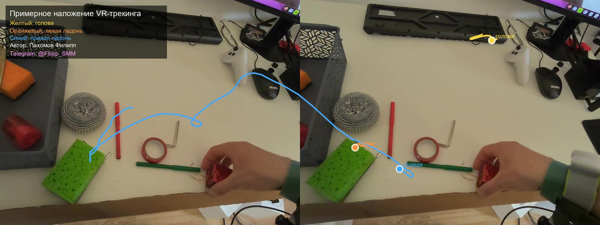

# VR Tracking — Data Light Тестовое задание

Небольшой Python-проект для визуализации данных движения, записанных VR-устройством XR-Robotics. Скрипт считывает исходное видео и файл трекинга, синхронизирует их по времени и сохраняет новое видео с цветными маркерами и короткими траекториями головы и ладоней.

## Результат

Пример обработанного кадра:



Также подготовлен пример видео с наложением на первые 30 секунд: [`overlay_test_30s.mp4`](screenshots/overlay_test_30s.mp4). 
При полном запуске скрипт создаёт `overlay_full.mp4`.

Цветовая легенда в кадре:

- **Жёлтый** — положение головы.
- **Оранжевый** — положение левой ладони.
- **Синий** — положение правой ладони.
## Выходное видео с трекингом
[Смотреть демонстрационное видео на YouTube](https://youtu.be/u3yY83Fyuss)

## Подход к визуализации
1. Файл трекинга читается построчно как JSON Lines: каждая строка после первой содержит запись с временной меткой `timeStampNs` и данными отслеживания.
2. Временные метки переводятся из наносекунд в секунды относительно начала записанного трекинга.
3. Из `Head.pose` извлекаются координаты положения головы. Для каждой руки берётся позиция первого элемента `HandJointLocations` — в используемой схеме он рассматривается как положение ладони.
4. Для каждого видеокадра определяется время `номер_кадра / FPS`. Скрипт выбирает последнюю запись трекинга, время которой не превышает время кадра.
5. Координаты X/Y нормализуются по диапазону движения и преобразуются в пиксели кадра. Затем рисуются маркеры, подписи и короткие шлейфы движения.
6. Обработанные кадры записываются в MP4, а первый кадр дополнительно сохраняется как `preview.jpg` рядом с выходным видео.

### Допущения и ограничения

Это **приближённая визуализация**, а не точная проекция VR-координат на изображение внешней камеры. Для точного наложения потребовались бы калибровка камеры и данные о взаимном положении и ориентации камеры и VR-системы. В текущем решении используются только координаты X/Y, а их диапазон масштабируется на область кадра. Поэтому маркеры показывают динамику трекинга, но их положение на изображении не следует интерпретировать как точное соответствие физическим точкам в кадре.

Синхронизация выполняется выбором предыдущей доступной записи трекинга, а не интерполяцией между записями. Если для головы или ладони нет координат, такая точка не добавляется в траекторию.

## Структура проекта

```text
vr-tracking-visualizer/
├── main.py
├── run.bat                 # запуск с выбором короткого теста или полного видео
├── requirements.txt
├── README.md
├── overlay_frame.jpg          # пример кадра для README
├── overlay_test_30s.mp4        # короткий пример результата
├── data/
│   ├── CameraRecord_20260505_165740.mp4
│   └── trackingData_20260505_165740.txt
├── screenshots/
│   ├── overlay_frame.jpg
│   └── overlay_test_30s.mp4
|   └── runbat.png
└── results/
    ├── overlay_full.mp4
    └── preview.jpg
```

Исходные видео и файл трекинга должны находиться в `data/` и не включаются в репозиторий. Папка `results/` создаётся автоматически при сохранении результата.

## Быстрая установка и запуск на Windows (Без ручного ввода команд)


#### Для запуска без ручного ввода команд можно использовать файл `run.bat` из корневой папки проекта:


1. Убедитесь, что установлен Python 3 и доступна команда `py -3` в командной строке.
2. Проверьте, что в корневой папке находятся `main.py`, `requirements.txt` и `run.bat`.
3. Поместите исходные файлы в папку `data/` с точными именами:
   - `data/CameraRecord_20260505_165740.mp4`
   - `data/trackingData_20260505_165740.txt`
4. Дважды щёлкните `run.bat` в Проводнике Windows. Скрипт создаст виртуальное окружение `.venv`, если оно ещё не существует, обновит `pip` и установит зависимости из `requirements.txt`.
5. В открывшемся окне выберите режим:
   - `1` — обработать первые 10 секунд и сохранить `results/overlay_test_10s.mp4`;
   - `2` — обработать полное видео и сохранить `results/overlay_full.mp4`.
6. Кадр предпросмотра сохраняется в `results/preview.jpg`. По завершении окно ожидает нажатия клавиши из-за команды `pause`.

Если одного из исходных файлов нет, BAT-файл покажет сообщение об отсутствующем файле, предложит поместить его в `data/` и завершится. После добавления файла запустите BAT повторно. Если выбран любой ввод, отличный от `1`, скрипт перейдёт к обработке полного видео, поэтому вводите `1` или `2`.
## Установка и запуск (Windows)

Требуется установленный Python 3. Создайте папку проекта и поместите исходное видео и файл трекинга в `data/` с именами, показанными выше. Откройте PowerShell в корневой папке проекта.

### 1. Создать виртуальное окружение

```powershell
py -3 -m venv .venv
.\.venv\Scripts\Activate.ps1
```

### 2. Установить зависимости

```powershell
python -m pip install --upgrade pip
python -m pip install opencv-python numpy pillow
```

Используемые библиотеки:

- **OpenCV (`opencv-python`)** — чтение видео, отрисовка маркеров и запись MP4;
- **NumPy** — обработка массивов координат и сопоставление временных меток;
- **Pillow** — отрисовка текстовых подписей с поддержкой кириллицы.

### 3. Проверить обработку на первых 10 секундах

```powershell
python main.py --max-seconds 10 --output results\overlay_test_10s.mp4
```

### 4. Обработать всё видео

```powershell
python main.py
```

По умолчанию скрипт использует следующие пути:

- входное видео: `data/CameraRecord_20260505_165740.mp4`;
- файл трекинга: `data/trackingData_20260505_165740.txt`;
- итоговое видео: `results/overlay_full.mp4`.

При необходимости пути можно указать явно:

```powershell
python main.py `
  --video data\CameraRecord_20260505_165740.mp4 `
  --tracking data\trackingData_20260505_165740.txt `
  --output results\overlay_full.mp4
```

Аргумент `--max-seconds` ограничивает длительность обработки и удобен для быстрой проверки. Если аргумент не указан, обрабатываются все доступные кадры видео.

## Наблюдения и сложности

- Наложение позволяет визуально проследить изменение положения головы и обеих ладоней во время записи.
- Временные метки трекинга записаны в наносекундах, поэтому для сопоставления с видео их необходимо перевести в секунды относительно начала записи.
- В строках координаты могут использовать десятичную запятую. Поэтому значения извлекаются регулярным выражением и преобразуются в числа, а не разбиваются простым `split(',')`.
- Не все записи обязательно содержат координаты каждой отслеживаемой части тела. Отсутствующие значения обрабатываются как пропущенные.
- Главная сложность — отсутствие калибровки, которая связывала бы координатную систему VR-устройства с системой координат внешней камеры. Поэтому результат намеренно обозначен как приблизительное наложение.
